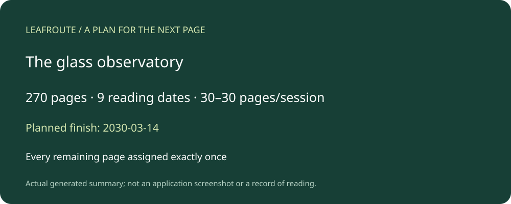

# Leafroute

Make room for the next page.

Leafroute turns a book deadline into exact, inclusive page ranges on the dates you can read. Choose weekdays, remove blackout dates, add an optional pace estimate, and take the complete plan with you.



This image is a real example export. A native application screenshot and native browser, responsive, assistive-technology, download, calendar-client and physical-print checks remain unverified. Automated UI checks use a simulated DOM.

## What it does

- Plans one manually entered book from the **last page completely finished** to its final numbered page.
- Counts both the start date and deadline.
- Uses your chosen reading weekdays and explicit blackout dates.
- Assigns every remaining page exactly once, with consecutive page ranges.
- Keeps excluded and unused dates visible in the complete schedule.
- Estimates time only from your optional, manually entered seconds per page.
- Exports an all-day calendar, project JSON, full CSV, HTML review, complete JSON receipt or summary SVG.
- Runs locally without accounts, uploads, analytics, external fonts, runtime dependencies or autosave.

A plan is not a reading log. Leafroute does not record sessions, infer completed pages, assess reading speed or promise that a workload fits your available time.

## Run locally

Use Node.js 22 or 24 and npm:

```sh
npm ci --ignore-scripts --no-audit --no-fund
npm test
npm run build
npm run dev
```

Open **http://127.0.0.1:4218**. The initial plan uses a fictional book and future example dates. Replace them with your own details.

The build copies ten allowlisted static assets into `dist/`. The pinned jsdom development dependency supports simulated UI checks only.

## Plan a book

1. Enter the total numbered pages and the last page you completely finished. Use **0** before page 1.
2. Choose your first reading date and finish-by date. Both endpoints are included.
3. Select the weekdays you can read.
4. Add any blackout dates, one `YYYY-MM-DD` value per line.
5. Optionally enter whole **seconds per page** from your own experience. Use 0 to omit estimates.
6. Select **Build reading plan** and review the complete schedule.
7. Save a project to preserve your settings, or download a report or calendar file.

Changes disable downloads until another successful build. Invalid drafts leave the last successful plan visible, explicitly marked as a previous plan. Filters and pagination affect only the preview; exports contain the complete built result.

There is no automatic catch-up. To replan, update the last finished page and first reading date, then build again. Dates are never silently advanced using the clock. Nothing is saved automatically when you close the page.

## How pages are assigned

Let **P** be the remaining pages and **D** the eligible dates after weekday and blackout exclusions.

- If P is positive and D is zero, the plan is rejected.
- Otherwise, the number of reading sessions is `N = min(P, D)`.
- Each session receives `floor(P / N)` pages.
- The first `P mod N` sessions receive one extra page.
- Sessions use the first N eligible dates.
- If the book is already complete, there are no assignments or calendar events.

For example, 11 pages across four eligible dates become **1–3**, **4–6**, **7–9**, **10–11**. Every range is inclusive. Loads differ by at most one page, with larger loads first.

When there are fewer pages than dates, the plan assigns one page to each of the earliest dates and finishes early. Later eligible dates are marked **No pages needed**.

All dates in the input range appear in the full schedule. A blackout takes precedence over the weekday label. The **Planned through** column is the cumulative target at the end of that date; it is not recorded progress.

This simple balance ignores chapter boundaries, page difficulty, multiple books, varying daily capacity and audiobook length. It does not optimize a schedule or evaluate whether the assigned reading is practical.

## Dates and time estimates

Dates are Gregorian civil dates, with no time of day. Internal UTC arithmetic keeps date iteration separate from daylight-saving clock changes; the plan does not schedule a particular hour or time zone.

Optional estimates use:

```text
session seconds = assigned pages × entered seconds per page
displayed session minutes = ceil(session seconds / 60)
```

The displayed total is the total exact estimated seconds rounded up once. Adding individually rounded session minutes can give a larger number. There is no default assumed reading speed, timer, measured history, reading assessment or comprehension estimate.

## Independent checks

Before enabling exports, a separate audit checks:

- Exact source identity and every date in the inclusive range.
- Weekday and blackout eligibility, including the earliest eligible session dates.
- Consecutive ranges, balance and cumulative targets.
- Every remaining page assigned exactly once.
- No assignments on rest dates.
- Estimates matching the entered pace.

Successful arithmetic checks do not establish that you have time to do the reading.

## Calendar export

The `.ics` file contains one **all-day tentative event** per planned reading session. It contains no alarms, attendees, invitations or recurring rules. Events are transparent to free/busy scheduling.

Import the downloaded file manually into your calendar and review it. Leafroute does not connect to a calendar account or synchronize changes.

The export follows the relevant [RFC 5545](https://www.rfc-editor.org/rfc/rfc5545.html) conventions: CRLF content lines, text escaping, UTF-8 folding to at most 75 octets per physical line, date-valued starts and exclusive next-day ends. Its creation timestamp is generated at export time.

A project has a persistent UUID. Event IDs combine that UUID and the reading date, so ordinary replanning preserves IDs for retained dates. Fresh interactive examples and cleared plans get new project IDs; opening a saved project retains its ID. The checked-in example uses a fixed sample identity and timestamp for reproducibility.

Calendar apps differ in how they handle re-imports: they may update, duplicate or leave old events. Removed dates are not sent as cancellations. Use a separate calendar or remove an older import before importing a revised plan where appropriate.

The calendar includes your book title, page ranges, pace description and notes. `CLASS:PRIVATE` is a calendar hint, not encryption or a sharing guarantee. Native calendar-client import behavior has not been tested.

## Exports and examples

| Download | Contents |
| --- | --- |
| `leafroute-plan.ics` | All reading sessions as all-day tentative calendar events |
| `leafroute-project.json` | Complete original inputs, stable project ID and notes |
| `leafroute-schedule.csv` | Every date, including rest dates, page ranges, cumulative targets and estimates |
| `leafroute-review.html` | Standalone complete review, including blackout inputs and notes |
| `leafroute-receipt.json` | Project, every date, all sessions and checked statistics |
| `leafroute-summary.svg` | Actual generated plan summary; not an application screenshot or reading record |

Projects, receipts, HTML and calendar files include private notes where applicable. Sharing an export shares that information.

CSV textual cells beginning with optional whitespace and `=`, `+`, `-` or `@` get an apostrophe prefix. This changes those values and helps guard spreadsheet formulas; it is not a universal spreadsheet security guarantee.

The [examples](examples/) contain six actual artifacts from a fictional book: pages 41–310, nine reading dates, 30 pages per session and an entered pace of 90 seconds per page. Regenerate them with `npm run example`.

## Limits and validation

- One book; 1–100,000 total numbered pages.
- Last finished page: a whole number from 0 through the total.
- Input dates: 2000–2099, at most 366 inclusive calendar dates.
- At least one unique weekday must be selected, including for a completed book.
- Up to 100 unique blackout dates, all inside the plan. Blank lines and surrounding spaces are ignored; duplicate or invalid dates are rejected.
- Optional pace: 0–3,600 whole seconds per page.
- Title: 80 characters on one line; notes: 500; raw blackout input: 1,200 UTF-16 code units.
- Project import: 60,000 bytes and 15,000 decoded UTF-16 code units, strict UTF-8 with an optional leading BOM.
- Unsafe ASCII controls, unpaired surrogates and U+FFFE/U+FFFF are rejected. Ordinary non-Latin text and emoji are supported.

Saved projects preserve raw blackout line endings across metadata-only edits. Editing the textarea itself uses the browser's LF normalization.

There is no book lookup, cover database, text upload, multi-book workload planning, progress history, chapter extraction, notifications, PDF generation, cloud backup or recovery after closing.

## Verification

`npm test` passes **26 automated checks**: 14 core checks, 11 simulated UI checks and their parent test.

Coverage includes:

- 1,000 generated cases checked against independent date-availability and per-page coverage oracles.
- Fourteen deliberately damaged plans rejected by the independent audit.
- Leap days, year boundaries, daylight-saving transitions and identical civil plans under UTC, America/New_York and Pacific/Auckland settings.
- Completed books, insufficient availability, early finishes, zero pace, resource limits and strict encodings.
- Calendar event counts, exclusive ends, stable/fresh IDs, escaping, UTF-8 folding and Unicode round trips.
- Complete JSON/HTML/CSV/SVG exports and actual Blob contents under filtering.
- Pagination, invalid drafts, reopening, CRLF preservation and stale asynchronous import races.

GitHub Actions tests and builds on Windows and Linux with Node 22 and 24. Simulated DOM checks do not verify real browser layout, assistive technology, touch behavior, actual download destinations, calendar applications or printed output.

## Manual Vercel setup

Import the repository into your Vercel account. Use the repository root, **Other** framework, Node **24.x**, build command `npm run build` and output directory `dist`.

The checked-in `vercel.json` supplies the static build and security headers. No runtime dependency installation, environment variables or paid resources are needed. Check the example, imports and downloads in your browser after deployment.

## License

[MIT](LICENSE).
